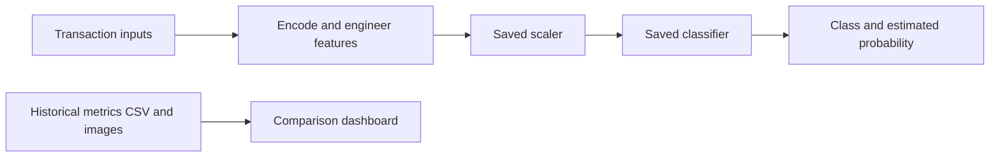
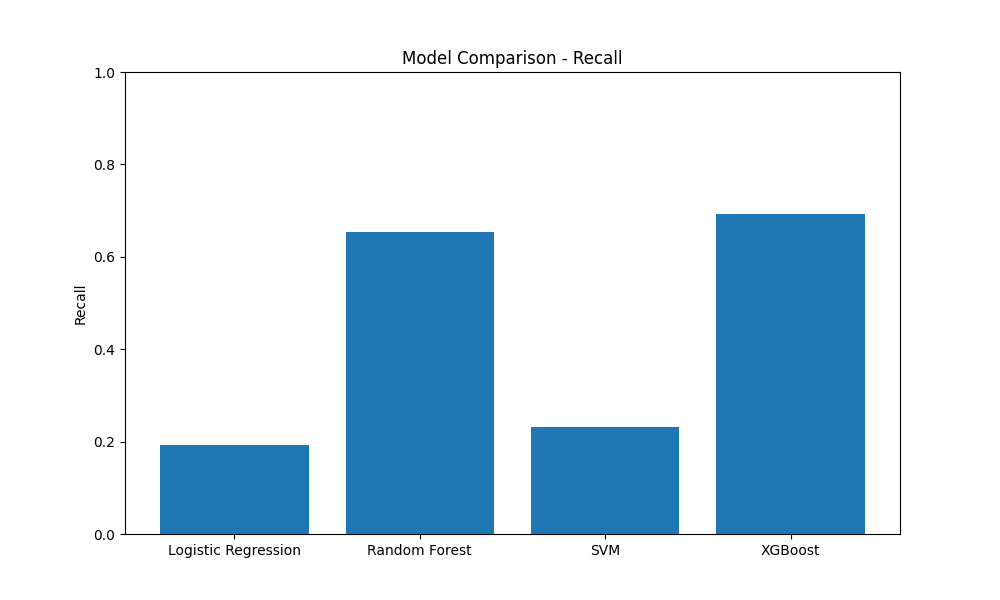

# Fraud Detection — Model Evaluation & Streamlit Demo

A machine-learning coursework project for exploring financial transaction classification with saved models, engineered features, historical comparison results, and a Streamlit interface.

**[Explore the app code](app.py) · [Evaluation script](fraud_detection.py) · [Saved metrics](results/model_comparison.csv)**

The current evaluation entry point loads existing model artifacts. Reproducible model training, SMOTE resampling, and SHAP generation are not implemented in that script.

## What you can explore

| Component | Current behavior |
| --- | --- |
| Model Comparison | Loads the saved metrics CSV and confusion-matrix images, and plots accuracy, precision, recall and F1. The UI filters out SVM. |
| Fraud Prediction | Encodes and scales transaction inputs, then calls a loaded classifier's `predict` and `predict_proba`. Models exposing `feature_importances_` also show a feature-importance chart. |
| Evaluation script | Combines two local CSV files, engineers features, makes a stratified 80/20 split with `random_state=42`, and evaluates saved models on the scaled test portion. |



## Historical results

These values come directly from the committed [model comparison CSV](results/model_comparison.csv). They are saved results, not a new evaluation or a guarantee of current performance. The CSV does not record the evaluation date, test-set size, class distribution, training versions or full experiment provenance.

| Model | Accuracy | Precision | Recall | F1 |
| --- | ---: | ---: | ---: | ---: |
| Logistic Regression | 99.895% | 100.00% | 19.23% | 32.26% |
| Random Forest | 99.955% | 100.00% | 65.38% | 79.07% |
| SVM | 99.900% | 100.00% | 23.08% | 37.50% |
| XGBoost | 99.960% | 100.00% | 69.23% | 81.82% |

High accuracy alone hides missed fraud: the saved Logistic Regression row reports 99.895% accuracy alongside 19.23% recall. Compare recall, precision and F1 together, and establish the data split and error costs before choosing a model for another dataset.



*Committed comparison plot. Random Forest and SVM have historical results, but their model files are absent from the current repository. LightGBM has a committed model and confusion matrix, but no row in this CSV. AUC is computed by the evaluation script; the saved CSV does not contain an AUC column.*

## Run the Streamlit demo

Use an isolated Python environment. The original training-library versions are not pinned, so dependency installation alone does not establish compatibility with the serialized artifacts.

```bash
git clone https://github.com/KhuzaimaHassan/Fraud-Detection.git
cd Fraud-Detection
python -m pip install -r requirements.txt
python -m pip install lightgbm pillow
python -m streamlit run app.py
```

LightGBM is needed to load `models/lightgbm.pkl`; the app imports Pillow as `PIL`. These direct dependencies are not explicitly listed in the current `requirements.txt`.

Run commands from the repository root because the app uses relative paths. The prediction/comparison UI requires the saved label encoder and scaler to load successfully. Individual model-load errors are displayed and that model is skipped. If loading fails, recover compatible artifacts and their training environment rather than treating the saved metrics as a new successful run.

The Streamlit path uses the existing models and results; the two evaluation CSV datasets below are not required by `app.py`.

### Committed artifacts

| File | Used by |
| --- | --- |
| `models/label_encoder.pkl` | Transaction-type encoding in the app and evaluator |
| `models/scaler.pkl` | Saved feature scaling in the app and evaluator |
| `models/logistic_regression.pkl` | App and evaluator |
| `models/xgboost.pkl` | App and evaluator |
| `models/lightgbm.pkl` | App and evaluator |

The code also looks for `models/random_forest.pkl`, and the evaluator looks for `models/svm.pkl`. Neither file is committed; missing files are reported and skipped. Model files are loaded through Joblib; use artifacts whose origin you trust.

## Evaluate saved models with your local data

Both datasets must be supplied locally. Their original download sources and the sampled-file construction procedure are not documented in this repository, so exact historical-result reproduction requires recovering that provenance as well as compatible model artifacts.

Place these files **beside `fraud_detection.py`**, not only in a `Datasets/` subdirectory:

```text
Fraud-Detection/
├── Fraud.csv                 # Required local input; not committed
├── FraudData_sampled.csv     # Required local input; not committed
├── fraud_detection.py
├── app.py
├── requirements.txt
├── setup.py                  # Legacy directory/dataset check
├── models/                   # Saved encoder, scaler and three classifiers
└── results/                  # Historical CSV and comparison/confusion plots
```

Expected fields include:

| Fields | Meaning |
| --- | --- |
| `step`, `type`, `amount` | Transaction step, category and amount |
| `oldbalanceOrg`, `newbalanceOrig` | Origin account balances |
| `oldbalanceDest`, `newbalanceDest` | Destination account balances |
| `isFraud` | Binary evaluation target |
| `nameOrig`, `nameDest` | Account identifiers, dropped when present as expected by the preprocessing code |
| `isFlaggedFraud` | Optional existing flag, excluded from features when present |

The saved encoder must recognize the transaction categories, and the feature columns must match the saved scaler and classifiers. The app offers CASH_IN, CASH_OUT, DEBIT, PAYMENT and TRANSFER.

```bash
python fraud_detection.py
```

This command prints accuracy, precision, recall, F1, ROC AUC and classification reports for available models, and writes their confusion-matrix images to `results/`. It does **not** retrain models or refresh `results/model_comparison.csv` and the saved metric-comparison plots; the app continues to read that historical CSV.

`setup.py` creates output directories and checks for datasets under `Datasets/`, which differs from the evaluator's root-relative paths. Its printed instruction calling evaluation “training” is outdated; use the paths and commands above.

## Feature engineering and current limits

Five derived features are implemented: origin balance difference, destination balance difference, a zero-origin-balance flag, an amount-to-origin-balance ratio, and an origin-balance-change ratio.

- **Preprocessing consistency:** `fraud_detection.py` uses `oldbalanceOrg + 1` as the denominator for its ratios; `app.py` uses `oldbalanceOrg + 1e-6`. These produce different values, so the two paths need alignment against the original training pipeline before their predictions and metrics can be compared reliably.
- **Evaluation provenance:** The script concatenates the full and sampled files before splitting. Their overlap and the saved models' original training data must be checked before claiming an independent, leakage-free test set.
- **Training and explanations:** SMOTE is imported but never applied. There is no model-fitting or SHAP-generation path in the current evaluator. The app's optional feature-importance chart uses model attributes rather than SHAP.
- **Reproducibility:** Restore the data sources, sampling recipe, fitted artifacts, feature schema and dependency versions before claiming a reproducible training/evaluation pipeline. No automated test suite or dependency lockfile is committed.

This is an educational classifier demonstration. Its outputs and historical metrics do not establish suitability for live financial decision-making.
